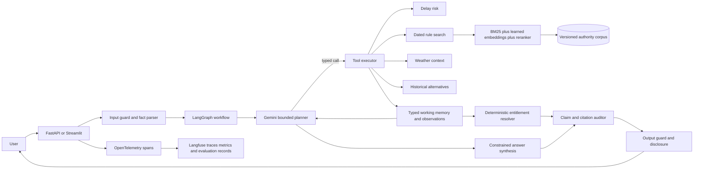

# Rerouted Updated System Specification

Version: 2.0  
Date: October 10, 2026  
Status: Implementation specification  
Supersedes for forward work: `docs/original_project_brief.md`

Implementation status: this document describes target architecture and planned work.
LangGraph, Gemini, OpenTelemetry, and Langfuse integrations remain unimplemented
scaffolding; see `docs/STATUS.md` for the running repository's actual state.

## 1. Purpose

Rerouted is a US air-disruption decision-support system. It helps a user understand:

- the risk of delay or cancellation;
- what published rules, enforcement notices, contracts, and commitments say;
- whether a refund obligation exists under the supplied facts;
- whether the applicable obligation was subject to a dated enforcement posture; and
- what historical alternative flights resemble possible options.

The upgraded system adds a bounded LLM planner and learned retrieval while preserving
deterministic legal resolution, citation auditing, refusal behavior, and reproducible local
operation. It treats agent orchestration as a measurable decision layer, not as authority over
legal conclusions.

Rerouted does not book, cancel, contact an airline, predict what an airline will actually do, or
provide legal advice. Alternative flights remain historical BTS schedule replays unless a future
spec explicitly introduces a licensed live-inventory source.

## 2. Current baseline

The repository already contains:

- four typed tools: `delay_risk`, `search_rules`, `weather_context`, and
  `find_alternatives`;
- FastAPI, Streamlit, official MCP Python SDK transports, Docker, Make, CI, linting, strict type
  checks, and automated tests;
- a bounded planner/executor runtime with validated arguments, tool-error observations, call,
  time, and cost budgets, output checks, and citation auditing;
- a production answer path using a deterministic local tool plan and deterministic entitlement
  resolver;
- dated eCFR, Federal Register, airline-contract, and DOT-commitment evidence with hashes and
  stable citations;
- a BTS and NOAA acquisition pipeline, 1.53 million materialized flight records, Parquet,
  DuckDB, chronological splits, calibrated delay/cancellation models, and provenance manifests;
- an 80-case synthetic candidate set, a 20-case independent-agent cold review, retrieval
  ablations, operational measurements, and CI-gate logic; and
- a dependency-free hybrid retriever whose current production configuration uses BM25, hashed
  token vectors, reciprocal-rank fusion, and lexical-overlap reranking.

The current measured answer path makes no LLM call. Its perfect synthetic resolver and citation
scores measure self-consistency against the project’s candidate labels, not human legal validity
or real-world passenger outcomes. Learned embedding and reranking decisions are documented but
not wired into the production rule-search path.

## 3. Goals

- Add LLM-directed tool selection and multi-turn clarification within strict bounds.
- Keep entitlement, enforcement posture, and load-bearing factual claims deterministic and
  auditable.
- Compare the LLM planner with the existing deterministic controller on the same cases.
- Integrate local learned embeddings and a cross-encoder reranker behind stable retrieval
  interfaces.
- Strengthen predictive-model baselines, temporal evaluation, calibration, and decision-utility
  reporting.
- Complete independent human/domain review and measured judge repeatability.
- Add incremental data-quality behavior, service telemetry, load tests, and a reproducible hosted
  demonstration.
- Run a preregistered user study measuring correctness and completion time.

## 3.1 Technology decisions for the upgraded system

| Concern | Selected technology | Role |
|---|---|---|
| Agent workflow | LangGraph | Stateful graph, conditional routing, checkpoints, retries, interrupts, and termination |
| LLM interfaces | LangChain Core | Message, prompt, runnable, and tool adapters without adopting the full LangChain stack |
| Planner and synthesis | Gemini through `google-genai` | Structured planning and constrained synthesis behind a provider-neutral interface |
| Contracts and configuration | Pydantic and Pydantic Settings | Agent state, tool arguments, observations, settings, and validation |
| Tool interoperability | Official MCP Python SDK | Expose the four typed tools to the application and compatible agent hosts |
| Learned retrieval | Sentence Transformers with `BAAI/bge-small-en-v1.5` | Local dense embeddings |
| Reranking | Sentence Transformers `CrossEncoder` | Neural reranking over a bounded candidate set |
| RAG evaluation | RAGAS plus custom domain evaluators | Supplementary RAG metrics alongside temporal, citation, resolver, and refusal metrics |
| Tracing | OpenTelemetry | Request, graph-node, retrieval, tool, resolver, and output spans |
| LLM observability | Langfuse | Prompt and model versions, traces, tokens, latency, cost, and failures |
| Prediction | scikit-learn plus XGBoost or LightGBM | Baselines and candidate delay and cancellation models |
| Statistical analysis | SciPy and statsmodels | Confidence intervals, tests, effect sizes, and user-study analysis |
| Analytical data | DuckDB, PyArrow, and Parquet | Local analytical storage, feature materialization, and SQL evaluation |
| API and UI | FastAPI, Uvicorn, HTTPX, and Streamlit | REST and MCP service, streaming, external APIs, and interactive UI |
| Packaging and quality | uv, Hatchling, pytest, mypy, and Ruff | Reproducible environments, testing, strict typing, and linting |
| Deployment | Docker, GitHub Actions, and Google Cloud Run | Container build, CI/CD, hosted demonstration, and rollback |

CrewAI is not part of the primary implementation. The product has one user goal, one shared
state, four bounded tools, and deterministic resolver and auditor components. Introducing
role-playing agents would add handoffs and model calls without an established need. A multi-agent
variant remains an optional measured experiment under RR-FR-05.

LangGraph is the production workflow layer. The existing custom `AgentRuntime` remains the
framework-independent reference implementation and deterministic test oracle so orchestration
behavior can be compared without making correctness depend only on a framework.

## 4. Non-goals

- Real booking, cancellation, refunds, airline contact, or payment handling.
- Live flight inventory without a separately approved and licensed provider.
- An unrestricted general-purpose agent.
- Allowing an LLM to decide legal entitlement or invent citations.
- Claiming legal validity from synthetic cases or agent-only review.
- Introducing multiple model agents unless an evaluated decomposition beats the single-planner
  design on quality, cost, or reliability.
- Long-term personalized memory, user profiling, or cross-user memory.
- Replacing domain-specific evaluation with one generic RAGAS score.

## 5. Authority and safety invariants

### RR-INV-01 Deterministic entitlement authority

Only the typed resolver may assign refund eligibility and enforcement posture. The LLM may gather
facts, select tools, and explain the resolver output. It may not override or reinterpret the
resolver’s structured result.

### RR-INV-02 Citation authority

Every load-bearing rule or contract claim must cite an active clause returned by the dated
retrieval layer and accepted by the grounding auditor. Missing support produces a qualified
partial answer or refusal.

### RR-INV-03 Obligation and enforcement separation

The system must never state that paused or discretionary enforcement extinguishes the underlying
obligation. Both fields remain separate in contracts, state, evaluation, and user output.

### RR-INV-04 Source-time integrity

Rule clauses, enforcement notices, weather, schedule data, and model features must be selected
using information available as of the relevant event or prediction timestamp. Later information
must not leak into a historical answer or model feature.

### RR-INV-05 Bounded agency

The planner is limited by model calls, tool calls, wall time, token count, and cost. Unknown tools,
invalid arguments, repeated loops, and stalled plans fail closed with recorded reasons.

### RR-INV-06 Product disclosure

Every answer states that it explains published rules and historical or modeled information, does
not provide legal advice, and does not contact or transact with an airline.

## 6. Target architecture

The deterministic controller remains an available baseline adapter. The LLM planner uses the
same tool contracts and resolver as the baseline so the comparison isolates planning and
language-generation behavior.

## 7. Functional requirements

### 7.1 Planner requirements

#### RR-FR-01 Planner contract

The planner must emit one of:

- typed tool calls;
- a typed request for missing information; or
- a final answer plan containing structured claims linked to observations.

Free-form tool names or arguments are invalid. The planner prompt must list allowed tools,
schemas, budgets, disclosure rules, and the distinction between observations and conclusions.

The production implementation represents parse, clarify, plan, execute, resolve, synthesize,
audit, refuse, and finish as explicit LangGraph nodes with typed state and conditional edges.
LangChain Core may normalize messages, model calls, prompts, and tool definitions, while Pydantic
domain contracts remain authoritative.

For multi-intent requests, the planner must decompose the user goal into explicit subgoals, record
their prerequisites and completion state, and select only the next executable subgoal. The graph
must replan after a material tool error, contradictory user fact, or changed goal. Goal and task
state must remain inspectable; free-form hidden plans are not execution state.

#### RR-FR-02 Clarification and state

The planner must identify missing facts required by the resolver, ask one focused clarification,
and retain supplied facts across turns. New user facts must be validated and versioned in state.
Contradictory updates require clarification rather than silent overwrite.

#### RR-FR-03 Adaptive tool use

The planner may choose subsequent tools based on validated observations. It must not call every
tool by default. It must stop when the answer has sufficient evidence or when a budget or refusal
condition is reached.

#### RR-FR-04 Error recovery

Tool timeout, unavailable live weather, missing local artifacts, invalid arguments, and empty
retrieval results become structured observations. The planner may retry only when the retry can
change the outcome and the retry budget remains. Otherwise it returns a bounded partial answer.

#### RR-FR-05 Single-agent default

One planner is the production default. Any multi-agent variant must define roles, handoff schemas,
termination conditions, extra cost, and a matched evaluation. It ships only if it improves a
predeclared metric without violating hard safety gates.

CrewAI is excluded from the primary implementation. An optional multi-agent experiment may use
LangGraph subgraphs or another isolated adapter, but it must not change the resolver, corpus,
tools, or frozen evaluation cases used by the single-agent baseline.

#### RR-FR-05A Checkpoints and interrupts

LangGraph must checkpoint validated state after fact parsing, each tool-result batch, resolver
execution, and citation audit. A failed model or tool call may resume from the last validated
checkpoint. Human review interrupts must be available before a simulated escalation or
low-confidence answer used to demonstrate approval workflows.

#### RR-FR-05B Graph termination

Every graph path must terminate in `finish`, `qualified_refusal`, `budget_exceeded`, or
`system_error`. Tests must prove that retries and cycles cannot exceed configured model-call,
tool-call, token, cost, and wall-time limits.

### 7.2 Resolver and answer requirements

#### RR-FR-06 Resolver isolation

Planner-generated prose cannot enter resolver logic. The resolver accepts only validated
`DisruptionFacts` and the versioned posture registry. Its result is attached to state as an
immutable observation.

#### RR-FR-07 Constrained synthesis

The final answer must be assembled from:

- deterministic entitlement and enforcement fields;
- audited clause summaries and links;
- measured delay or cancellation output with its uncertainty and timestamp;
- historical alternatives labeled as historical; and
- unresolved facts and conditional branches.

The LLM can improve readability but cannot change structured values. A deterministic renderer
must remain available as fallback and comparison baseline.

#### RR-FR-08 Refusal and uncertainty

If a load-bearing fact or source is missing, state what is known, what remains unknown, and how
the answer changes under the relevant condition. Do not fill missing facts with model guesses.

### 7.2.1 Context and memory requirements

#### RR-FR-08A Structured working memory

Agent memory is session-scoped typed state containing:

- validated user facts and their turn of origin;
- unresolved and contradictory facts;
- selected tool calls and validated observations;
- resolver and enforcement-posture outputs;
- retrieved clause identifiers and source versions;
- planner decisions and remaining budgets; and
- citation-audit and fallback outcomes.

The implementation must not store free-form hidden reasoning. Long-term personalized memory is
outside scope.

#### RR-FR-08B Context assembly

Build model context from explicit sections: system policy, current goal, validated facts,
unresolved facts, compact tool observations, active source excerpts, budgets, and required output
schema. Include only evidence needed for the current graph node. Tool output and retrieved
documents are untrusted data and must not be concatenated into the instruction section.

#### RR-FR-08C Context compression and invalidation

When state exceeds its context budget, compress prior observations into typed summaries that
preserve values, timestamps, source IDs, errors, and unresolved facts. New contradictory facts
invalidate dependent plans and answers. Retrieval results expire when the event date, carrier,
authority filter, or corpus version changes.

### 7.3 Retrieval requirements

#### RR-FR-09 Learned embeddings

Implement an embedding provider interface with:

- local `BAAI/bge-small-en-v1.5` as the primary learned provider;
- deterministic hash vectors as an offline test fallback; and
- versioned embedding metadata and corpus hashes.

Production configuration must report which provider actually served a query. A hash-vector run
must not be described as semantic-model retrieval.

Use Sentence Transformers for local BGE inference. Cache corpus embeddings by document hash,
embedding-model identifier, pooling configuration, and normalization settings. Query and document
instructions must follow the selected BGE model contract and remain versioned.

#### RR-FR-10 Cross-encoder reranking

Add a local cross-encoder over a bounded fused candidate set. Record model version, candidate
count, rerank latency, and fallback reason. If unavailable, retain RRF order and identify the
fallback in the trace.

Use the Sentence Transformers `CrossEncoder` interface. Select the concrete checkpoint through the
reviewed retrieval benchmark; do not make an unevaluated checkpoint the production default.

#### RR-FR-11 Temporal and authority filtering

Filter by active interval, authority type, carrier, and jurisdiction before final ranking. Keep
substantive obligations and enforcement-policy notices in separate retrieval layers.

#### RR-FR-12 Retrieval evaluation

Create independently reviewed query-relevance judgments that include citation identifiers,
paraphrases, colloquial requests, conflicting clauses, date boundaries, and unanswerable queries.
Compare:

- BM25;
- deterministic hash vectors;
- learned dense retrieval;
- BM25 plus learned dense retrieval with RRF; and
- hybrid retrieval plus cross-encoder reranking.

Report recall at 5 and 10, MRR, nDCG at 10, latency, memory, and index-build cost. Select the
default from the measured tradeoff rather than architecture preference.

Run RAGAS faithfulness, context precision, context recall, and answer-relevance metrics where their
input contracts fit. Record model and prompt versions for each model-scored metric. RAGAS is
supplementary and cannot override clause-level citation, temporal-validity, resolver, or refusal
gates.

### 7.4 Predictive model and data requirements

#### RR-FR-13 Prediction timestamp

Define the prediction timestamp for every training and inference row. Features must be available
at or before that timestamp. Tail-history, weather, route, carrier, and airport aggregates must
use strict prior-time joins.

#### RR-FR-14 Baselines and candidate models

Evaluate at minimum:

- overall historical rate;
- route and carrier historical-rate baselines;
- regularized logistic regression; and
- one established tree-boosting implementation.

Use scikit-learn for logistic regression, preprocessing, metrics, and calibration interfaces.
Evaluate XGBoost or LightGBM as the boosted-tree candidate. If both are installed, compare them
under the same folds and compute budget.

Compare them with the existing model under identical chronological folds and sampling. Select the
model using predeclared discrimination, calibration, latency, and simplicity criteria.

#### RR-FR-15 Temporal robustness

Evaluate multiple rolling or forward temporal windows. Report AUROC, average precision, Brier
score, ECE, reliability curves, threshold utility, subgroup results, and label prevalence for
delay and cancellation separately.

Calibration is selected only on validation data and assessed on untouched test windows. If
calibration worsens a held-out target, serve the uncalibrated probability for that target and
record the decision.

#### RR-FR-16 Uncertainty

Document exactly what each interval covers. Empirically measure coverage and width on held-out
windows. Do not label a residual probability interval as an outcome or causal uncertainty
interval.

#### RR-FR-17 Incremental pipeline

Support idempotent monthly ingestion with source checksums, schema checks, deduplication,
late-arriving corrections, freshness status, explicit station/time-zone mappings, and lineage
from raw files to model artifacts. Provide SQL data-quality tests and measured query plans for the
main analytical joins.

### 7.5 Service and interface requirements

#### RR-FR-18 API compatibility

Keep the four existing tool contracts stable. Extend schemas through versioned additive fields or
an explicit migration. REST, Streamlit, and MCP must expose equivalent structured results.

#### RR-FR-19 Tracing and telemetry

Record per request:

- trace and session ID;
- planner/model version;
- tool calls, retries, validation errors, and durations;
- retrieval provider and ranked clause IDs;
- resolver result and cited clauses;
- token counts and estimated model cost;
- final disposition and refusal reason; and
- cache behavior.

Exclude booking locators, contact data, and other unnecessary personal information.

Instrument FastAPI, LangGraph nodes, Gemini calls, retrieval, reranking, tool execution, resolver,
auditor, and output guard with OpenTelemetry spans. Export LLM-oriented traces and evaluation
metadata to Langfuse through a configurable adapter. Local development must support a no-export
mode that preserves structured local traces without requiring a Langfuse account.

Prompt templates, graph version, Gemini model identifier, generation configuration, embedding and
reranker versions, corpus hash, and evaluation version must be searchable trace attributes. Never
record secrets, full personal identifiers, or unrestricted raw user content by default.

#### RR-FR-20 Hosted demonstration

Provide a reproducible container deployment with health, readiness, and version endpoints; secret
injection; request size and rate limits; structured logs; rollback instructions; and a documented
shutdown path. The deployment target may be Cloud Run or an equivalent service. Hosting must not
change the local-first tool and evaluation contracts.

The reference hosted profile uses Google Cloud Run, Artifact Registry, Secret Manager, and Cloud
Logging. Set minimum instances to zero for the portfolio deployment unless measured cold-start
requirements justify another setting. Gemini, Langfuse, and other remote integrations must use
runtime secrets and explicit network timeouts. Credentials must not be embedded in an image or
committed to Git.

#### RR-FR-21 Load and recovery tests

Measure latency, error rate, memory, and cost under a documented modest concurrent load. Exercise
model timeout, embedding failure, weather failure, malformed planner output, missing model
artifact, and deployment rollback.

## 8. Evaluation specification

### 8.1 Evaluation tracks

Run and report these tracks independently:

1. deterministic answer-service baseline;
2. LLM planner with deterministic final renderer;
3. LLM planner with constrained LLM synthesis; and
4. optional multi-agent experiment, if implemented.

All tracks use the same tool implementations, resolver, corpus snapshot, and scenario facts.

For the production tracks, record LangGraph and LangChain Core versions, graph-definition
version, Gemini model identifier, prompt hash, and provider configuration. The custom runtime
remains a reference track for orchestration regressions.

### 8.2 Scenario coverage

Expand the existing cases with:

- missing and contradictory facts;
- colloquial multi-intent requests;
- irrelevant or out-of-scope prompts;
- tool failures and partial availability;
- dated clause and enforcement boundaries;
- airline-contract differences;
- retrieval paraphrases and distractors;
- unnecessary-tool-call traps;
- planner loops and budget exhaustion; and
- adversarial instructions to omit citations or overstate legal certainty.

### 8.3 Metrics

- end-to-end task completion;
- resolver agreement by behavior family;
- enforcement-posture exact match;
- citation precision, recall, and unsupported-claim rate;
- correct clarification and refusal rates;
- unnecessary and invalid tool calls;
- planner loop and recovery rates;
- retrieval recall, MRR, and nDCG;
- p50 and p95 latency;
- tokens and cost per completed task;
- deterministic-fallback rate; and
- user-study correctness, completion time, confidence, and usability.

List RAGAS metrics and LLM-judge scores in a separate model-scored section. Deterministic and
human-reviewed metrics remain the release authority.

### 8.4 Independent review

- A qualified human/domain reviewer must adjudicate the candidate golden cases without seeing
  system predictions.
- Resolve disagreements through recorded rationale and source citations.
- Freeze an approved test set that was not used to tune prompts, retrieval, or resolver behavior.
- If an external LLM judge is retained, run the same held-out answers at least twice and publish
  judge variance. The judge cannot replace human domain review.

### 8.5 Controlled user study

Preregister the primary outcome, assignment or counterbalancing method, task set, exclusion rules,
and analysis before collecting outcomes. Compare task completion with and without Rerouted. Measure
correctness, time, unsupported conclusions, and user confidence. Report sample size, uncertainty,
missing data, and limitations. Do not claim real passenger or financial impact from a simulated
study.

### 8.6 Release gates

- Zero obligation/enforcement conflations.
- Zero unsupported load-bearing claims in the frozen reviewed set.
- Citation precision at least 0.90 and no regression from the approved baseline.
- No unresolved hard-gate status caused by missing baseline artifacts.
- All planner outputs and tool arguments validate against schemas.
- No infinite loops or execution beyond configured budgets.
- Deployment readiness and rollback tests pass.
- Learned retrieval must meet the predeclared relevance/latency threshold or the simpler measured
  baseline remains the default.
- Public claims distinguish synthetic evaluation, human review, model prediction, and real-world
  outcomes.

## 9. CI and artifact requirements

CI must run:

- formatting, lint, strict type checks, unit tests, and integration tests;
- deterministic resolver and guardrail regressions;
- tool-contract compatibility tests;
- small offline retrieval tests without downloading models;
- approved metric gates using committed compact reports; and
- migration and configuration validation.

CI must validate the LangGraph topology, require typed state at every node boundary, prove cyclic
paths are budget-bounded, and run provider calls through deterministic fakes. Offline CI must not
require Gemini, Langfuse, model downloads, or cloud credentials. A separate credentialed workflow
may run Gemini, learned embeddings, the cross-encoder, RAGAS, and trace export against pinned
versions.

Large source data, learned model weights, secrets, and raw traces remain outside Git. Commit
manifests, hashes, compact metrics, schemas, and reproducible commands. A release record must tie
the code revision to corpus, embedding, reranker, predictive-model, planner, prompt, and evaluation
versions.

## 10. Implementation sequence

1. Freeze the current deterministic baseline and approve CI measurements.
2. Add Sentence Transformers BGE embeddings and CrossEncoder reranking, then complete the reviewed
   retrieval benchmark and supplementary RAGAS run.
3. Strengthen scikit-learn and boosted-tree baselines, temporal windows, calibration selection,
   and interval evaluation.
4. Implement the single bounded Gemini planner as a LangGraph workflow over the existing four
   tools, using LangChain Core adapters and Pydantic state.
5. Add session working memory, context budgeting, checkpointing, and constrained synthesis while
   preserving resolver and citation authority.
6. Expand adversarial and failure-recovery evaluation; complete human/domain adjudication and
   judge repeatability.
7. Add incremental pipeline checks, OpenTelemetry and Langfuse tracing, load tests, and a
   reproducible Cloud Run deployment.
8. Conduct and report the preregistered user study.
9. Consider a multi-agent comparison only after the single-agent system has a frozen baseline.

## 11. Definition of done

Rerouted 2.0 is complete when:

- a user can submit an ambiguous disruption question, provide missing facts over multiple turns,
  and receive a bounded, cited answer generated from validated tool observations;
- the LLM planner is measurably compared with the deterministic controller;
- the resolver remains the sole authority for entitlement and enforcement posture;
- learned retrieval and reranking are integrated, identified in traces, and selected through a
  reviewed benchmark;
- prediction metrics come from untouched chronological windows and include credible baselines,
  calibration decisions, subgroup results, and uncertainty coverage;
- human/domain review, judge repeatability, frozen CI baselines, load tests, and rollback tests are
  complete;
- the local and hosted profiles produce the same structured decision semantics;
- LangGraph, Gemini, learned retrieval, RAGAS, OpenTelemetry, and Langfuse runs are tied to pinned
  versions and reproducible trace and evaluation artifacts; and
- documentation and portfolio claims clearly state the data period, synthetic components,
  limitations, and absence of airline transactions or legal advice.
